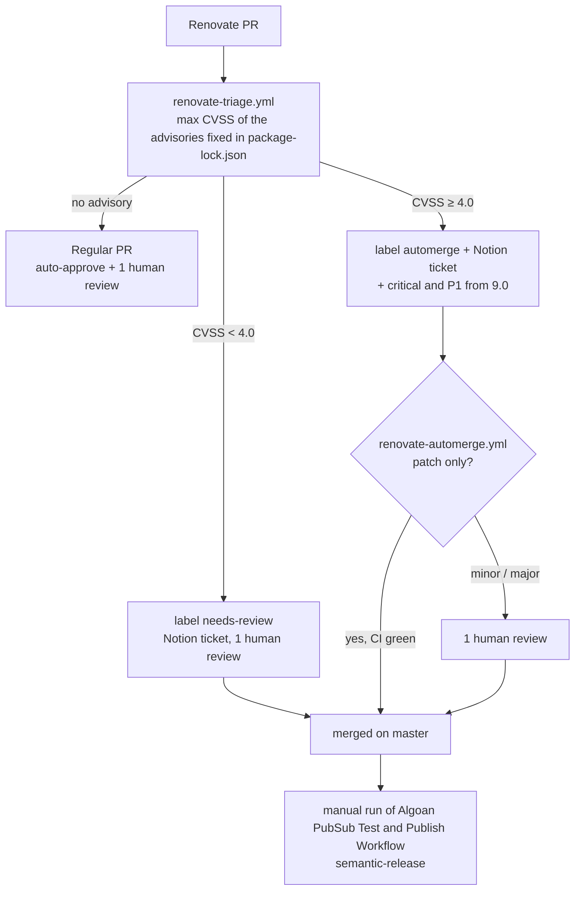

# Dependency updates (Renovate)

Dependencies are kept up to date by the hosted [Mend Renovate](https://developer.mend.io/github/algoan/pubsub)
app, configured in [`renovate.json`](../renovate.json). It replaces the Dependabot version updates;
Dependabot alerts stay on. Security fixes are routed by the CVSS of the vulnerabilities they fix,
with the shared actions of [`algoan/private-actions`](https://github.com/algoan/private-actions/tree/beta/renovate-security)
(`renovate-security`), the same flow as `algoan/backend`. The **hotfix flow is off**: nothing is
deployed from this repository.

## What happens after a merge

A merge on `master` only runs the tests. `@algoan/pubsub` reaches npmjs.com and GitHub Packages
only when someone runs **Algoan PubSub Test and Publish Workflow** manually (`semantic-release`,
angular preset). Renovate's commits follow the conventional format (`:semanticCommits`):
`fix(deps): …` for a runtime dependency gives a patch release, `chore(deps): …` (dev dependencies,
lockfile maintenance) releases nothing.

So a security fix in a runtime dependency (`@google-cloud/pubsub`, `@grpc/grpc-js`, `pino`) reaches
consumers at the next release: run the publish workflow once it is merged. A fix that only moves
`package-lock.json` changes nothing for consumers, who resolve their own lockfile.

## What Renovate updates

| Manager          | Files                                  |
| ---------------- | -------------------------------------- |
| `npm`            | `package.json` and `package-lock.json` |
| `github-actions` | `.github/workflows/*.yml`              |

Routine updates are grouped into one weekly PR (Monday before 6am, Europe/Paris); majors come on
the same schedule, one PR each. Lockfile maintenance runs weekly too. `examples/google-pubsub` is
left out (Renovate ignores `examples/` by default, as Dependabot did with its `/` directory).

Security PRs are opened immediately at the **lowest fixing version**
(`vulnerabilityFixStrategy: lowest`). They keep the range of the dependency and raise its floor
(`rangeStrategy: bump`, e.g. `^1.14.6` → `^1.14.7`) instead of pinning it: `@algoan/pubsub` is a
library, an exact version would be forced on every consumer.

## Routing

- **`renovate-triage.yml`** (`pull_request_target`) scores the packages changed in
  `package-lock.json` with the GitHub Advisory Database. The highest CVSS decides the tier. For a
  security PR it creates or updates a `Vulnerability` ticket in Notion, prefixes the title with
  `[ALG-NNNN]`, sets the `security` label plus `automerge` or `needs-review` (and `critical` from
  9.0), and comments the advisories. It only runs for PRs opened by `renovate[bot]`, from the
  base commit: nothing from the PR runs with the secrets, which matters on this public repository.
- **`renovate-auto-approve.yml`** approves every Renovate commit as `github-actions`: with the
  2-approval rule of `master`, a Renovate PR then needs **one human review**.
- **`renovate-automerge.yml`** squash-merges PRs labelled `automerge` once every required check
  (`Tests`, `Socket Security: Pull Request Alerts`) is green, as the `algoan-merger` GitHub App
  (bypass actor of the master ruleset). It recomputes the tier for the head commit, requires every
  commit to be authored by Renovate and signed by GitHub, and only accepts changes to dependency
  files. Only **patch** bumps merge automatically; minor/major wait for a human.
- **Critical fixes (CVSS ≥ 9.0)** take the same path with the `critical` label and a P1 ticket:
  release quickly once merged.

`Tests` is a job of `test-and-publish.yaml` that waits for the Node.js matrix: the matrix job names
(`test (22.x, 11)`) change with the versions and contain a comma, which `required_checks` can't hold.
The `test` job has `continue-on-error`, so the workflow run stays green when a test fails:
`renovate-automerge` still refuses the merge, because it requires every check run of the head
commit to have succeeded.

## Configuration

| Repository variable         | Default                                      | Notes                               |
| --------------------------- | -------------------------------------------- | ----------------------------------- |
| `CVSS_AUTOMERGE_THRESHOLD`  | `4.0`                                        |                                     |
| `CVSS_HOTFIX_THRESHOLD`     | `9.0`                                        | Unused while the hotfix flow is off |
| `AUTOMERGE_REQUIRED_CHECKS` | `Tests,Socket Security: Pull Request Alerts` | Comma-separated check names         |
| `NOTION_SUB_TECH_TEAM`      | `Back`                                       | Sub-tech-team of the Notion tickets |

Org secrets used: `REPO_GHA_PAT` (private-actions checkout), `ALGOAN_MERGER_APP_ID`,
`ALGOAN_MERGER_PRIVATE_KEY`, `NOTION_TOKEN`. Repository settings: Renovate and `algoan-merger`
apps installed, Dependabot alerts on, squash merging allowed (the automerge squash-merges),
_Allow GitHub Actions to create and approve pull requests_, master ruleset with **2 approvals**,
_dismiss stale approvals_, the checks above required, and `algoan-merger` as bypass actor in
_pull requests only_ mode.
